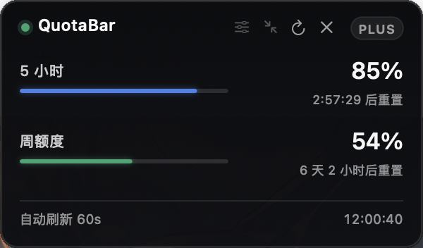
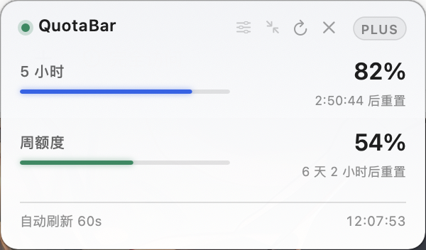
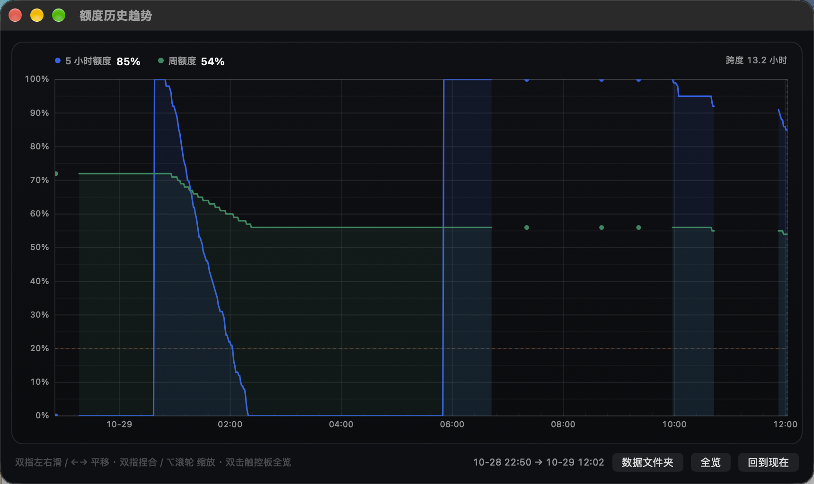
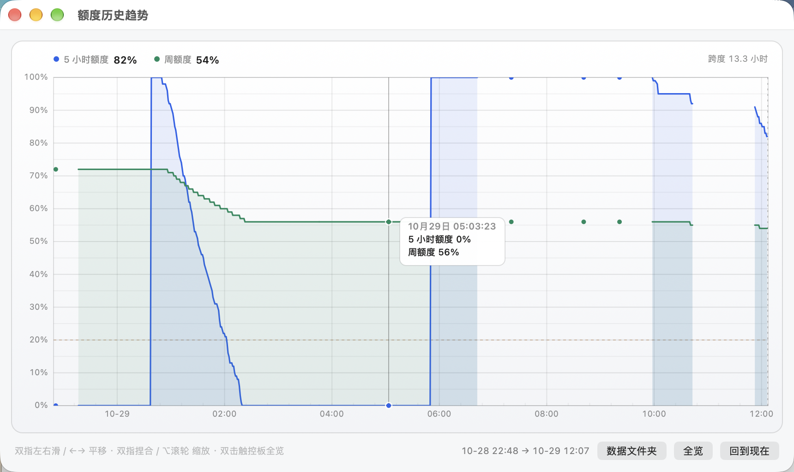
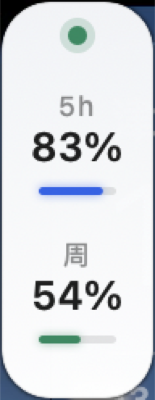

# QuotaDock

QuotaDock 是一个原生 macOS 菜单栏额度监控工具。它通过本机 Codex helper 的 app-server 接口读取额度窗口，在桌面边缘显示剩余额度，并用本地历史数据绘制消耗曲线和预计见底时间。

当 5 小时额度和周额度同时变化时，单看当前百分比很难判断消耗节奏。QuotaDock 把短窗口、长窗口、下一次重置和历史速率放在同一处，帮助你观察使用情况并规划工作。

> 源码版本：**2.0.0（Build 20）** · 最低系统：**macOS 14** · 主要针对 **Apple Silicon** 构建。

## 实际运行界面

以下均为 QuotaDock 在开发者 Mac 上的真实运行截图，包含截图时的实时额度与重置时间。额度会随账号、套餐和时间变化；图片用于展示界面和功能，不是固定示例值或服务保证。部分早期 HUD 截图仍显示旧界面名称 QuotaBar，项目及当前应用名称为 QuotaDock。

| 深色 HUD | 浅色 HUD |
|---|---|
|  |  |

| 深色额度趋势 | 浅色额度趋势 |
|---|---|
|  |  |

| 竖向迷你条 | 横向迷你条 |
|---|---|
|  |  |

QuotaDock 是独立的社区工具，不是 Codex 或 ChatGPT 官方应用。它依赖本机 Codex app-server 协议；该协议随 Codex 更新可能变化，也不是公开兼容性承诺。

## 功能

- **菜单栏状态**：显示优先额度窗口的剩余比例、套餐/账号状态和运行状态。
- **桌面悬浮条**：将当前额度放在桌面边缘，可吸附屏幕边缘、跨 Space 显示和切换徽标样式。
- **历史趋势**：按额度窗口画剩余比例，标出重置时刻和当前时刻；支持缩放与日期刻度。
- **消耗预测**：使用最近一段采样拟合下降速度，显示可能的见底时间；采样不足、速度接近零、额度已耗尽时会分别标记，不硬造预测。
- **重置识别**：从额度明显回升识别重置；短窗口和周额度的重置线在图表中合并展示。
- **多额度窗口**：兼容多个额度组和旧格式的单组响应，优先展示 Codex 主额度组。
- **提醒**：额度低于用户设置阈值时通知；可配置是否提示重置。
- **外观与交互**：浅色/深色主题、中文/英文、全局快捷键、窗口置顶选项、截图时允许选中悬浮窗等设置。
- **本地历史账本**：成功读取后以 JSONL 记录各窗口剩余比例和重置时间，保留 45 天，不上传该账本。

## 预测如何工作

预测使用剩余额度百分比对时间做线性最小二乘拟合，并换算为每分钟下降的百分点数。

1. 先拟合最近 **20 分钟**，捕捉短窗口突然加速的消耗。
2. 近期样本不足或速度不明显时，回退到 **1 小时**窗口，照顾较慢的长期额度变化。
3. 至少需要 4 个样本、跨度至少 4 分钟；相邻采样断档超过 20 分钟时不跨断档拟合。
4. 每分钟下降不到 0.02 个百分点视为平稳；额度剩余不超过 0.2% 时标记为耗尽。
5. 若主额度已耗尽而其他额度被服务端拦截，冻结/平移预测，不把阻挡期间的平线误当成原来的消耗速度。

曲线、悬停预测点和「见底时间」共用同一份拟合结果。预测是按近期历史外推的估计值，不代表服务承诺、精确计费或未来保证。

## 额度数据来源与边界

QuotaDock 启动本机 Codex helper，并通过标准输入/输出上的 JSON-RPC 消息读取账号和 rate-limit 数据。应用本身不实现网页登录，也不直接保存或解析浏览器 Cookie。helper 负责其自身的登录状态、网络访问和与 Codex 服务的通信。

额度字段和 app-server 协议可能随 Codex 更新而变化。若 helper 不再返回可识别的 rate-limit 数据，QuotaDock 会显示等待、登录或错误状态；它无法绕过服务端限制，也不能保证适用于未提供额度数据的账号、套餐或地区。

## 隐私与本机数据

- 额度账本只写入本机 Application Support 的 QuotaDock/Ledger 子目录，按天存为 JSONL，过期文件在启动时清理，保留 45 天。
- 设置通过 macOS UserDefaults 本地保存。
- Codex helper 单独运行在本机子进程中，并使用 QuotaDock/Codex 作为独立 CODEX_HOME，避免与用户全局 Codex 配置混用。
- QuotaDock 不包含内置遥测服务或自己的远程账号后端。Codex helper 的联网和账号行为仍由其安装来源及其产品设置决定。
- 用户可能会在界面中看到账号邮箱、额度和套餐信息。提交截图、诊断材料或 issue 前，请先检查并遮盖个人数据。

## 构建

需要 macOS 14 或更高版本、Xcode 命令行工具和一个可执行的 Codex helper。项目将 helper 复制到本地生成的 App Bundle 中，但**不在源码仓库中分发该 helper 二进制**。构建和签名只在本机进行。

优先通过 QUOTADOCK_CODEX_PATH 指定 Codex helper 可执行文件；若未指定，构建脚本会寻找 PATH 中的 codex，或当前本机已安装的 QuotaDock 内置 helper。外部运行时可用 CODEX_BINARY_PATH 指定。具体路径随安装方式可能不同。

<pre><code>git clone https://github.com/tunianbututou/QuotaDock.git
cd QuotaDock
QUOTADOCK_CODEX_PATH="/path/to/codex" ./build.sh
open build/QuotaDock.app</code></pre>

构建目标是 arm64、macOS 14。生成的 App 使用本机 ad-hoc 签名，不包含 Apple Developer ID 公证；首次运行可能需要在 Finder 中右键 App 并选择「打开」。要将构建结果安装至 /Applications，请显式运行 ./build.sh install；此操作会替换原有 QuotaDock.app，并将旧包留在本地 build/prev.app。

当前实现调用 xcrun 和 swiftc 编译 Swift 源码，没有 Swift Package Manager 或第三方 Swift 运行时依赖。构建还需要一个本地 Codex helper；其许可与更新由对应安装渠道决定，不属于本仓库 MIT 许可范围。

## 项目结构

<pre><code>QuotaDock/
├── Sources/
│   ├── QuotaBridge.swift       # 本机 Codex helper 生命周期与 JSON-RPC 桥
│   ├── QuotaStream.swift       # 连接、刷新、退避重试和状态流
│   ├── QuotaModel.swift        # 额度窗口与响应解码
│   ├── QuotaForecast.swift    # 速率拟合与见底预测
│   ├── UsageLedger.swift      # 本地 JSONL 历史账本
│   ├── ResetMoments.swift     # 重置时刻识别与合并
│   ├── AlertRulebook.swift    # 低额度与重置提醒规则
│   ├── WidgetHost.swift       # 悬浮窗与贴边行为
│   ├── TimelineWindow.swift   # 历史趋势窗口
│   ├── TimelinePlot.swift     # 趋势曲线、缩放和刻度
│   ├── StatusBarHost.swift    # 菜单栏状态与快捷键
│   ├── Preferences*.swift     # 偏好和设置窗口
│   ├── Localization.swift     # 中英文文本
│   └── main.swift             # 应用生命周期
├── Resources/
│   ├── Info.plist
│   └── QuotaDock.icns
├── QuotaDock.entitlements
├── Helper.entitlements
└── build.sh</code></pre>

更详细的模块职责、数据流和限制见 docs/ARCHITECTURE.md。

## 开源许可

本仓库中的 QuotaDock 源码以 [MIT License](LICENSE) 发布。Codex helper 不包含在仓库中，也不由该许可重新授权。
